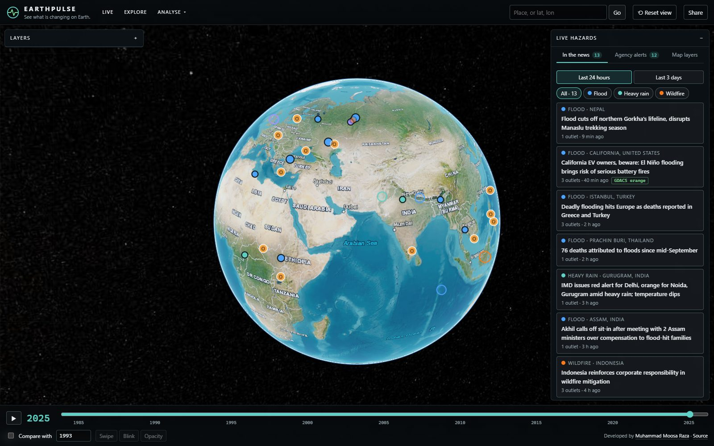
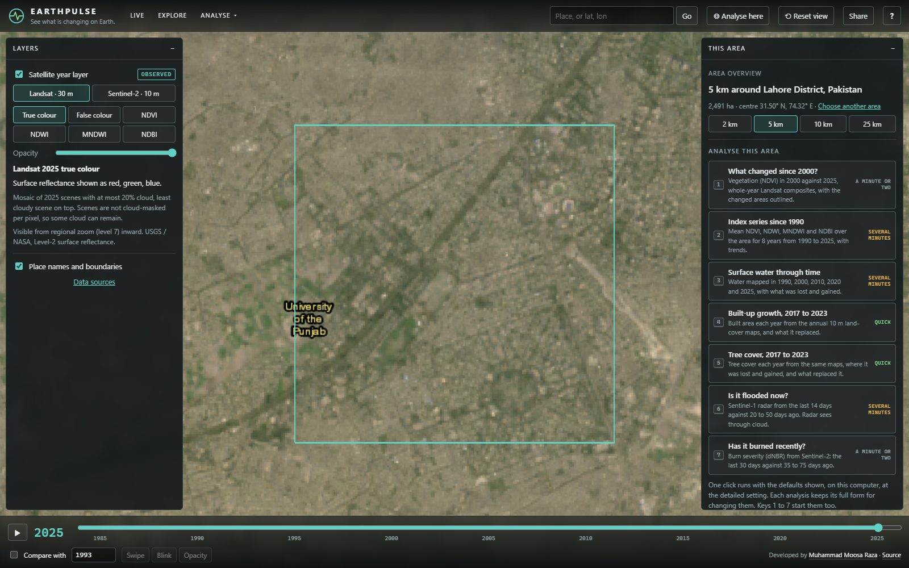
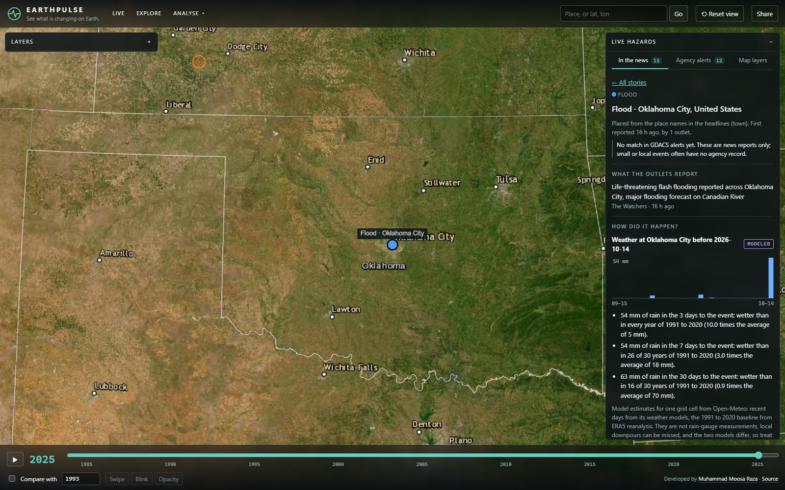
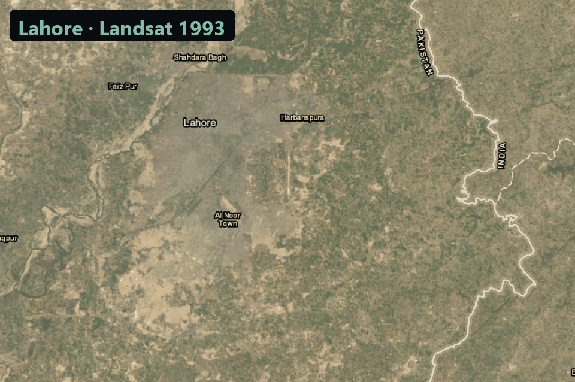
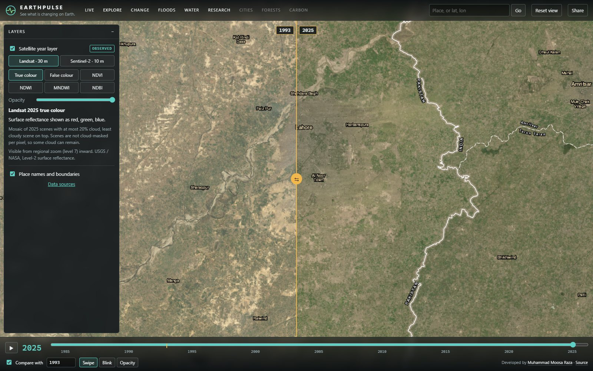
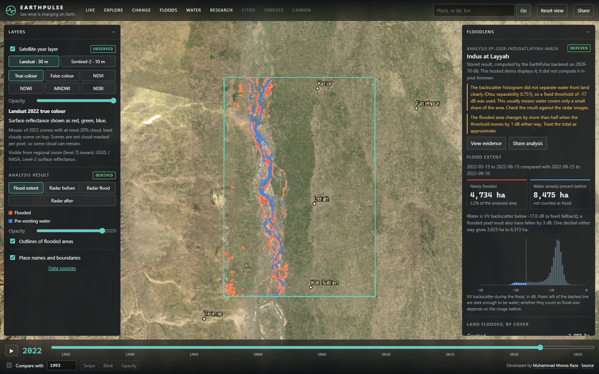
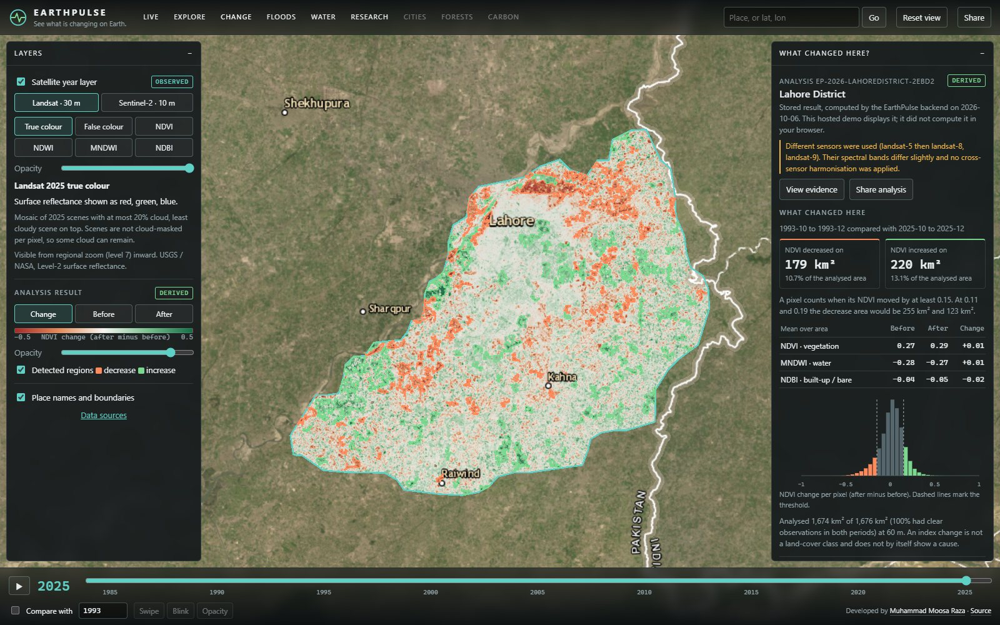
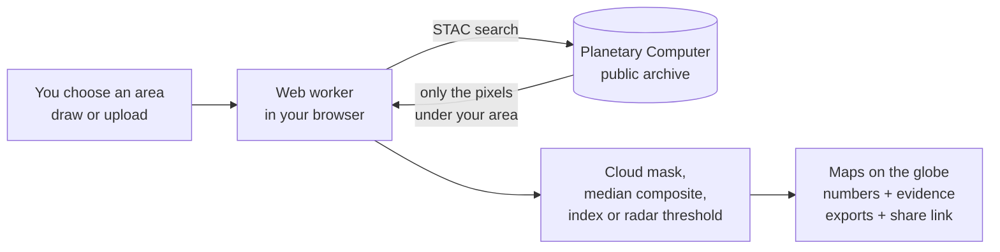

<div align="center">

# 🌍 EarthPulse

### See what is changing on Earth, with the evidence behind every number.

**[Open the live app →](https://moosarazauaf.github.io/earthpulse/)**

No account. No API key. No server. Satellite analyses run on your own computer.

[](https://github.com/moosarazauaf/earthpulse/actions/workflows/ci.yml)
[](https://moosarazauaf.github.io/earthpulse/)
[](LICENSE)
[](https://github.com/moosarazauaf/earthpulse/releases)



</div>

EarthPulse puts four decades of open satellite imagery, live hazard feeds and
a reproducible analysis engine on one 3D globe in the browser. Ask *"what
changed here?"* about any place on Earth and get an answer that names the
scenes, the method and the limits behind it.

## Why it is different

- **It runs on your machine.** Change detection, flood mapping and
  surface-water tracking happen in a web worker in your browser, which reads
  Landsat, Sentinel-1 and Sentinel-2 files straight from the public archive.
  The heavy work happens on visitors' machines, so the site itself is just
  static files on free hosting.
- **No claim without evidence.** Every result lists the exact scenes used,
  the cloud mask, the formula, the threshold, how sensitive the answer is to
  that threshold, and what the method cannot see. Values are labelled
  *observed*, *derived*, *modelled* or *estimated*, never mixed up.
- **Share a link, not a screenshot.** A shared analysis link carries the full
  recipe. Whoever opens it re-runs the same analysis on their own device.
  [Try one: surface water at Mangla Reservoir, 2000 and 2025.](https://moosarazauaf.github.io/earthpulse/?lat=33.15&lon=73.7&h=90000&run=eyJ2IjoxLCJrIjoid2F0ZXIiLCJtIjoyNTAwMDAsInIiOnsiYW9pIjp7InR5cGUiOiJQb2x5Z29uIiwiY29vcmRpbmF0ZXMiOltbWzczLjU1LDMzLjAyXSxbNzMuODUsMzMuMDJdLFs3My44NSwzMy4zXSxbNzMuNTUsMzMuM10sWzczLjU1LDMzLjAyXV1dfSwibGFiZWwiOiJNYW5nbGEgUmVzZXJ2b2lyIiwiZGF0YXNldCI6ImxhbmRzYXQiLCJ5ZWFycyI6WzIwMDAsMjAyNV0sInN0YXJ0TW9udGgiOjEwLCJlbmRNb250aCI6MTIsInRocmVzaG9sZCI6MCwibWF4Q2xvdWQiOjIwfX0)
- **Your area, your file.** Draw a rectangle or polygon, or drop in a zipped
  shapefile or GeoJSON. It is read in the browser and never uploaded.

## What you can do

### 🎯 Click a place, get an analysis
Press **Analyse here** (or <kbd>A</kbd>) and click anywhere on the globe. EarthPulse
makes a square area of 2 to 25 km around the spot, names it, and in a few
seconds shows its land cover (ESA WorldCover), its terrain (elevation range,
slopes, where landslides are possible), its 1991 to 2020 climate and how the
last twelve months compare, and any hazard news, earthquakes or alerts
nearby. Below that are eight analyses that start with one click or one key
(<kbd>1</kbd> to <kbd>8</kbd>), each with its defaults written next to it: what changed
since 2000, an index series since 1990, surface water through time,
built-up growth, tree cover, how hot the ground gets, whether it is flooded
now, and whether it has burned recently. Drawing or uploading an area opens
the same overview; **☆ Save** keeps it in My places (<kbd>M</kbd>) together with
your recent analyses, and **Print report** saves the overview as a PDF. Saved
places are watched: when EarthPulse opens it tells you about hazard news,
earthquakes or alerts near any of them. The overview also shows the rain of
the last days against normal, and says when an unusually wet week falls on
steep ground, the conditions in which landslides happen.



### 🔴 See what is happening now
Current red and orange disaster alerts (GDACS), active fire detections (NASA
VIIRS), river flood forecasts and observed flood extent (Copernicus GloFAS),
fire danger (Copernicus GWIS) and the past week's earthquakes (USGS). Each
layer says who publishes it, whether it is an observation or a forecast, and
what it is not. EarthPulse shows these products; it is not a warning service.

### 📰 Hazards in the news, and how they happened
Every hour EarthPulse scans more than 30 news outlets (BBC, The Guardian, NYT,
Dawn, Rappler, ABC Australia, ReliefWeb and more) for earthquakes, floods,
landslides, storms and wildfires, and puts each story on the globe with links
to every outlet that reported it. Stories are checked against the USGS
earthquake catalogue and GDACS alerts. Open one and EarthPulse shows what led
up to it, for example *"54 mm of rain in the 3 days before: wetter than in
any year from 1991 to 2020"*. One click then proposes the satellite analysis
that can test the story: flood water from radar, a burn scar, or landslide
scars.



### 🛰️ Compare any two years since 1984
Annual Landsat and Sentinel-2 layers in true colour, false colour and four
spectral indices, with a timeline and a swipe, blink or blend comparison.





### 🌊 Map a flood from radar
**FloodLens** maps flood extent from Sentinel-1, which sees through cloud. It
picks one radar orbit that covers your area in every window, separates water
that was already there, chooses the water threshold from the data, and reports
flooded cropland and built-up land, recession, and how much the answer moves if
the threshold is off by 1 dB.



### 🔥 Map how badly land burned
**FireWatch** compares Landsat or Sentinel-2 before and after a fire, computes
the differenced Normalized Burn Ratio (dNBR), and maps burn severity in the
standard classes of Key and Benson (2006), with the area in each class.

### 🌱 Measure change
Pick two years and a season; EarthPulse builds cloud-free composites for both,
computes NDVI, NDWI, MNDWI or NDBI, and maps where the index moved past a
threshold, with the largest regions listed and the distribution plotted.



### 🏙️ Follow a city's growth
**UrbanEye** counts built-up land in each annual 10 m land-cover map from 2017
to 2023, maps where it spread, and says what it replaced: crops, trees,
rangeland or bare ground. The maps are machine-learning classifications, and
the result is labelled that way.

### 🌡️ Find the hottest ground
**HeatWatch** maps land surface temperature in the hot season from Landsat's
thermal band, with the average, the hottest tenth, how much cooler green
ground is than bare or built ground (about 4 °C in central Lahore in summer
2025), and the change since an earlier year. It says plainly that this is
late-morning ground temperature, not air temperature.

### 🌳 Check tree cover
**ForestEye** follows the Trees class of the same annual maps: where tree
cover was lost and gained from 2017 to 2023, and what the lost tree cover
became (crops, pasture, buildings). It says plainly that leaving the Trees
class is a change of map class, not deforestation as FAO defines it.

### 🗺️ Classify land cover with your own samples
Upload training points or polygons (GeoJSON or a zipped shapefile) with a
class attribute, and **Classify** trains a random forest on a Sentinel-2 or
Landsat composite in your browser, maps every pixel, and reports a
confusion matrix, overall accuracy, kappa, and producer's and user's
accuracy on samples held back from training. The split is made by feature,
not by pixel, so pixels from one polygon never sit on both sides and the
accuracy is not inflated. Class map as GeoTIFF, confusion matrix as CSV.
A Lahore example set is built in to try it.

### 📈 Follow an index for decades
**Research** computes mean NDVI, NDWI, MNDWI and NDBI over your area for up
to 12 years since 1984, with per-decade trends that leave out years with too
little clear view. Every result exports as CSV and JSON; change, burn, flood and
heat maps as GeoTIFF for QGIS or ArcGIS; and change and burn analyses also as
a Google Earth Engine script that repeats them with the same scenes. The
measuring tool (<kbd>D</kbd>) gives distances and areas on the ground.

### ⌨️ Keyboard first
<kbd>L</kbd> Live, <kbd>E</kbd> Explore, <kbd>A</kbd> Analyse here, <kbd>M</kbd> My places, <kbd>D</kbd> measure, <kbd>R</kbd>/<kbd>P</kbd> draw, <kbd>U</kbd> upload,
<kbd>←</kbd>/<kbd>→</kbd> years, <kbd>Space</kbd> play, <kbd>C</kbd> compare, <kbd>/</kbd> search,
<kbd>Shift</kbd>+<kbd>1</kbd>–<kbd>9</kbd> analyses. Press <kbd>?</kbd> in the app for the full list.

### 💧 Track surface water year by year
**WaterWatch** maps water for up to nine years, plots the area through time
(missing years stay empty, never interpolated), and shows how persistent each
water pixel is and what was lost or gained. A year player steps through the
maps on the globe.

## How it works



The engine reads cloud-optimised GeoTIFFs with HTTP range requests at the
resolution it needs, so a district-sized analysis downloads a few megabytes
per scene rather than gigabytes. It picks the working resolution from your
device's cores and memory, and you can trade detail for speed.
[docs/ARCHITECTURE.md](docs/ARCHITECTURE.md) has the full design, including
the optional Python backend.

| Data | Resolution | Since | Used for |
|---|---|---|---|
| Landsat 4–9 Collection 2 L2 | 30 m | 1984 | Year layers, change, water |
| Sentinel-2 L2A | 10 m | 2016 | Year layers, change, water |
| Sentinel-1 RTC (radar) | 10 m | 2014 | FloodLens |
| ESA WorldCover 2021 | 10 m | 2021 | Land under floodwater |
| Impact Observatory annual land cover | 10 m | 2017 | UrbanEye |
| GDACS, NASA FIRMS, GloFAS, GWIS, USGS | varies | live | Live view |
| News RSS feeds + GeoNames gazetteer | headline | hourly | Hazard news |
| Open-Meteo (forecast models, ERA5) | ~10–25 km | 1991 | Weather and climate context |
| Landsat Collection 2 surface temperature | 100 m (as 30 m) | 1984 | HeatWatch |
| AWS Terrain Tiles (SRTM, GMTED2010) | ~30 m | static | Terrain in the area overview |

All of it is open and keyless. Licences and attribution are in
[docs/DATA_SOURCES.md](docs/DATA_SOURCES.md).

## Run it yourself

The live app needs nothing installed. To develop:

```bash
git clone https://github.com/moosarazauaf/earthpulse
cd earthpulse/frontend
npm install
npm run dev
```

Open http://localhost:5173. That is the whole application; analyses run in
the browser. The optional Python backend (multi-year index series, Earth
Engine script export) is described in [docs/DEPLOY.md](docs/DEPLOY.md).

EarthPulse can also be installed as a desktop app from Chrome or Edge (the
install icon in the address bar).

## Honest limits

- Analyses download imagery, so speed depends on your connection. A
  district-sized Sentinel-1 flood analysis is about 10 MB per radar pass.
- No result has been validated against ground data. Every result says so and
  shows how sensitive it is to its own threshold.
- An index change is not a land-cover class and does not show a cause.
- Live layers are other agencies' products, shown as published.
- News stories are found by keyword and placed by place name, automatically.
  Some will be off-topic or misplaced; every story links to its sources.

## Roadmap

Pre-2017 built-up history, forest disturbance from Landsat, land-cover classification with accuracy assessment, carbon
accounting with exposed equations, and story mode. See [docs/ROADMAP.md](docs/ROADMAP.md) and
[CHANGELOG.md](CHANGELOG.md).

## Contributing

Contributions are welcome, especially new open data sources, analyses and
translations. Read [CONTRIBUTING.md](CONTRIBUTING.md) first: it sets the
scientific rules every change must follow. Issues labelled
[good first issue](https://github.com/moosarazauaf/earthpulse/labels/good%20first%20issue)
are a good place to start.

## Citing EarthPulse

If EarthPulse helps your research, cite it with the metadata in
[CITATION.cff](CITATION.cff) (GitHub's "Cite this repository" button), and
cite the data providers listed in [docs/DATA_SOURCES.md](docs/DATA_SOURCES.md).

## Acknowledgements

Imagery and catalogue access: Microsoft Planetary Computer, USGS, ESA and the
Copernicus programme. Hazard feeds: GDACS, NASA FIRMS and GIBS, Copernicus
Emergency Management Service, USGS. Globe: CesiumJS. Several interface ideas
(grouped layers that state their source and limits, click-to-inspect markers,
one-click reset, coordinate search) came from studying
[God's Eye View](https://github.com/bilawalsidhu/gods-eye-view) by Bilawal
Sidhu and Sameh Khamis (MIT). No code, assets or data from that project are
included; EarthPulse covers environmental change and hazards and does not
track aircraft, vessels, cameras or people.

## Author

Built by **Muhammad Moosa Raza**, remote sensing and GIS
([portfolio](https://moosarazauaf.github.io/), [GitHub](https://github.com/moosarazauaf)).

## Responsible use and licence

EarthPulse works at landscape scale on public data and does not identify,
track or profile people. Code: MIT ([LICENSE](LICENSE)). Data keeps its
providers' licences.
